# X-Station

**PlayStation × Xbox – 50/50 verschmolzen.** X-Station ist eine Web-App für **PC, Mac und iPad mit Controller** mit Konsolen-Oberfläche und **vollständiger Xbox-Controller-Unterstützung**: oben die Kachelreihe, die großen Hintergrundbilder und die weichen Animationen der PS5, darunter die Kachel-Blöcke, der seitliche Guide und das Grün der Xbox. Das Ganze ist ein eigenes System mit Konten, Freundesliste, Chat, Erfolgen, Musik und einem funktionierenden Webbrowser.

> **Hinweis:** X-Station ist ein inoffizielles Fan-Projekt und steht in **keiner Verbindung** zu Sony Interactive Entertainment oder Microsoft. Es werden **keine offiziellen Engines, Betriebssysteme, Logos, Schriftarten oder Sounds** verwendet. Alle Spiele sind fiktive Platzhalter und **nicht spielbar**. „PlayStation“, „PS5“, „Xbox“ und „Xbox Series X|S“ sind Marken ihrer jeweiligen Inhaber.

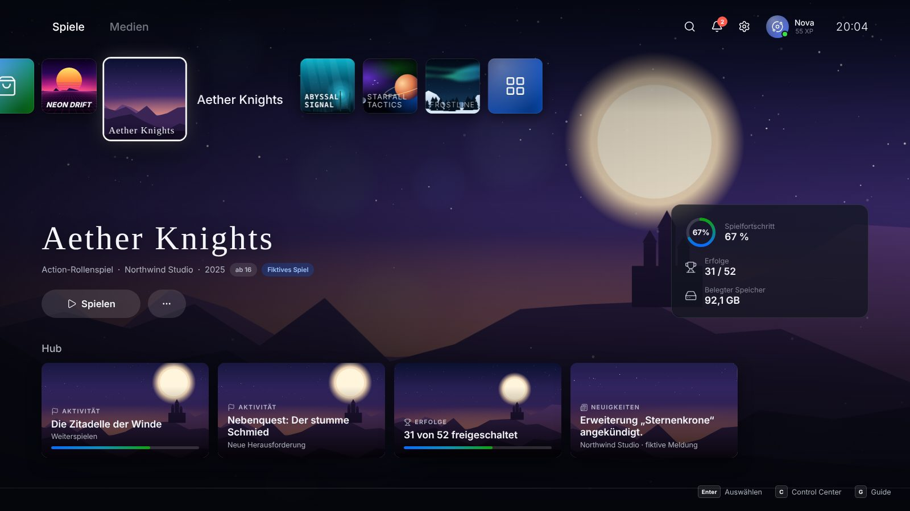

## Funktionen

| Bereich | Was es kann | Inspiration |
| --- | --- | --- |
| **Einschalten & Boot** | Einschalt-Taste, Partikel-Boot mit Lichtexplosion, eigener Startklang | PS5 |
| **Nutzungsbedingungen** | Pflicht beim ersten Start: zwei Häkchen, u. a. die Bestätigung, dass X-Station nichts mit PlayStation/Xbox zu tun hat und keine offiziellen Engines oder Betriebssysteme nutzt | – |
| **Benutzer** | „Wer benutzt X-Station?“, Registrierung mit Avatar, Anmeldung, mehrere Konten pro Gerät | PS5 |
| **Startseite** | Reiter Spiele/Medien, wachsende Kacheln mit Titel daneben, Hintergrund-Überblendung, Hub-Karten | PS5 |
| **Startseite (unten)** | Kachel-Blöcke für Freunde, Store und System | Xbox |
| **Control Center** | **View**-Taste (Xbox), PS-Taste oder Taste **C**: Karten für zuletzt genutzte Apps, Downloads, Musik, Freunde sowie Ton, Barrierefreiheit, Netzwerk und Ein/Aus | PS5 |
| **Guide** | **Xbox**-Taste oder Taste **G**: seitliches Panel mit Reitern für Freunde, Chats, Benachrichtigungen, Erfolge und Profil & System | Xbox |
| **Freundesliste** | Echte registrierte Nutzer suchen, Anfragen senden, annehmen oder ablehnen, Online-Status und Aktivität live (z. B. „Surft im Web“) | Xbox |
| **Chat** | Nachrichten zwischen Freunden in Echtzeit, mit Benachrichtigungen | Xbox |
| **Browser** | Tabs, Adressleiste, Suche, Verlauf. Webseiten laufen über einen Proxy in einer isolierten Sandbox. Mit dem Controller gibt es einen Cursor, Klicks, Texteingabe per Bildschirmtastatur und Scrollen | Xbox-Browser |
| **Erfolge** | 12 Erfolge mit XP und Freischalt-Animation | Xbox-Popup, PS5-Stufen |
| **Musik** | 4 generative Ambient-Sender, live per Web Audio erzeugt | PS5 |
| **Store & Bibliothek** | Fiktive Spiele „herunterladen“ (simuliert, mit Fortschritt im Control Center); ein Spielstart erklärt, dass X-Station keine Spiele ausführt | PS5 und Xbox |
| **Einstellungen** | Konto, Design (Akzent Hybrid/PS-Blau/Xbox-Grün), Ton, Barrierefreiheit, Browser, Steuerung, System und **Info mit Credits und rechtlichem Hinweis** | Xbox-Navigation, PS5-Listen |

### Xbox-Controller (volle Unterstützung)

X-Station lässt sich komplett ohne Maus und Tastatur bedienen – unterstützt werden Xbox Series X|S, Xbox One, Xbox Elite, Xbox Adaptive und Xbox 360 Controller (USB, Xbox Wireless Adapter oder Bluetooth).

| Taste | Funktion |
| --- | --- |
| **A** | Auswählen |
| **B** | Zurück · im Browser: vorherige Seite |
| **X** | Kontextaktion · Löschen in der Bildschirmtastatur · Play/Pause in Musik |
| **Y** | Suche · Adressleiste im Browser · Leerzeichen in der Bildschirmtastatur |
| **LB / RB** | Reiter wechseln (Spiele/Medien, Guide, Browser-Tabs, Einstellungen, Bibliothek, Musik-Sender) |
| **LT / RT** | Seitenweise scrollen · Umschalt/Symbole in der Bildschirmtastatur (analog ausgelesen) |
| **View** | Control Center · gedrückt halten: Guide |
| **Menu** | Optionen zum ausgewählten Element · „Fertig“ in der Bildschirmtastatur |
| **Xbox-Taste** | Guide · gedrückt halten: Ein/Aus-Optionen |
| **Share** | Control Center |
| **Linker Stick** | Fokus bewegen · **Cursor im Browser** (Klicks auf Links, Buttons, Formulare) |
| **Rechter Stick** | Stufenlos scrollen – überall |
| **Steuerkreuz** | Fokus bewegen · im Browser scrollen |

Außerdem:

- **Bildschirmtastatur** im Xbox-Stil (QWERTZ mit Umlauten und Symbolen) für alle Textfelder – auch für Eingabefelder auf Webseiten im Browser.
- **Vibration** bei Auswahl, Benachrichtigungen, Spielstarts und Erfolgen, inklusive **Trigger-Vibration**, wo der Browser sie unterstützt. Stärke einstellbar.
- **Controller-Test** unter *Einstellungen › Controller & Steuerung*: alle Tasten, Sticks und Trigger live, dazu Vibrationstest, Totzone und Cursor-Tempo.
- Verbindungs-Hinweise mit Modellerkennung, Tastensymbole im Xbox-Stil und Unterstützung für die abweichende Tastenbelegung von Firefox unter Linux.
- Öffnet die Xbox-Taste unter Windows die Xbox Game Bar, erreichst du den Guide, indem du **View gedrückt hältst**.
- Browser geben Controller nur auf sicheren Seiten frei: X-Station deshalb über **HTTPS** oder **localhost** öffnen.

### Tastatur & Maus

| Aktion | Tastatur |
| --- | --- |
| Bewegen | Pfeiltasten / WASD |
| Auswählen | Enter / Leertaste |
| Zurück | Esc / Rücktaste |
| Control Center | C / Pos1 / F1 |
| Guide | G / F2 |
| Reiter wechseln | Q / E |
| Seitenweise scrollen | Bild ↑ / Bild ↓ |
| Optionen | M |

Mit der Maus öffnet die X-Station-Taste unten links das Control Center, ein Rechtsklick darauf öffnet den Guide.

### Unterstützte Geräte

- **PC und Mac:** voll unterstützt (Controller, Tastatur und Maus).
- **iPad:** unterstützt, **solange ein Controller verbunden ist**. Ohne Controller erscheint „Controller verbinden“. Wird der Controller getrennt, pausiert X-Station, bis er wieder verbunden ist. Nur im Querformat.
- **Smartphones und Tablets anderer Hersteller:** nicht unterstützt, es erscheint nur ein Hinweis.

## Screenshots

| | |
| --- | --- |
|  | 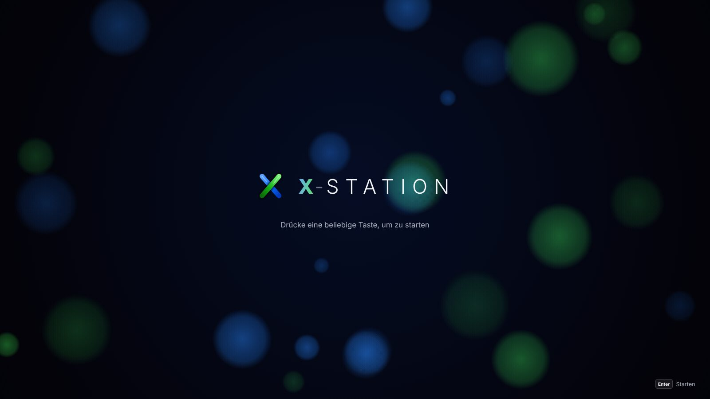 |
| 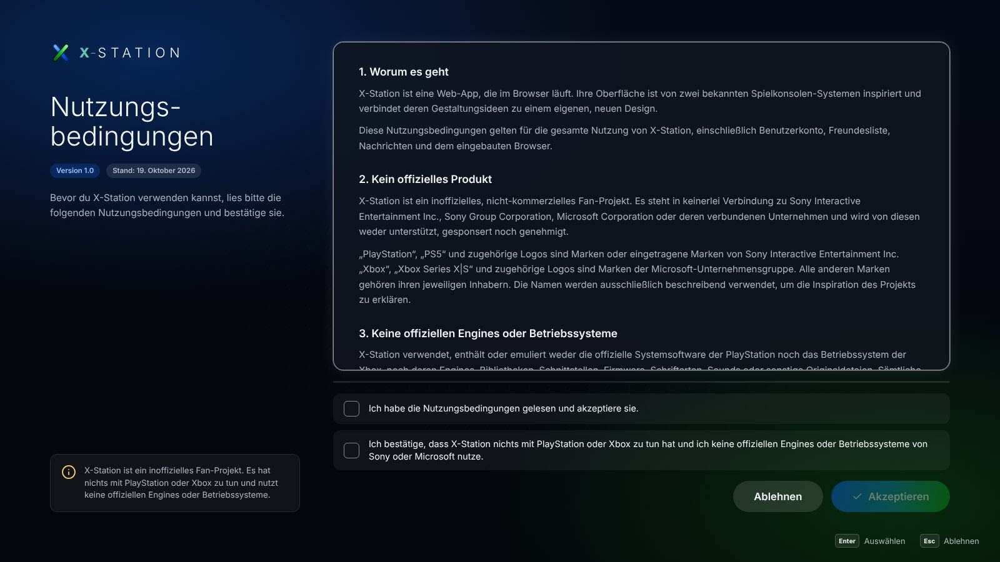 | 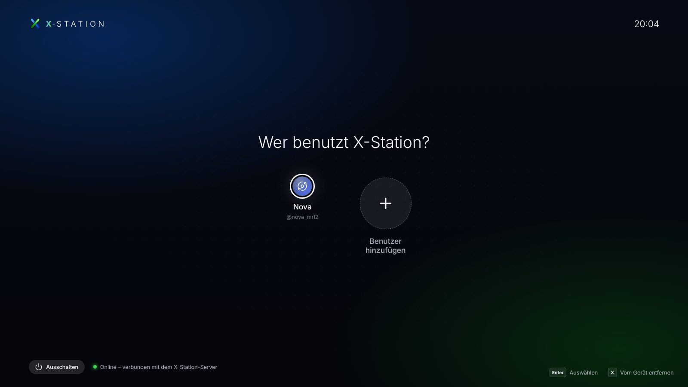 |
| 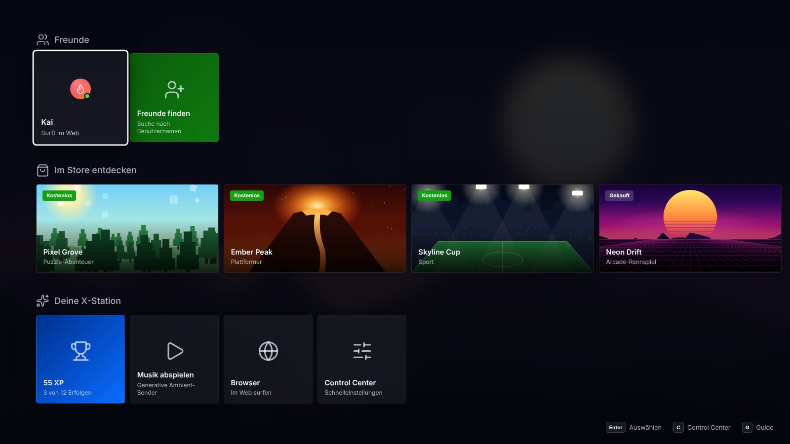 | 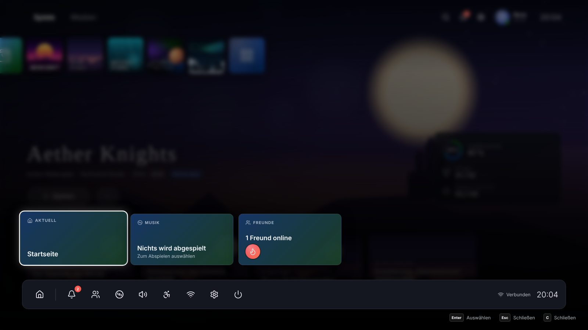 |
| 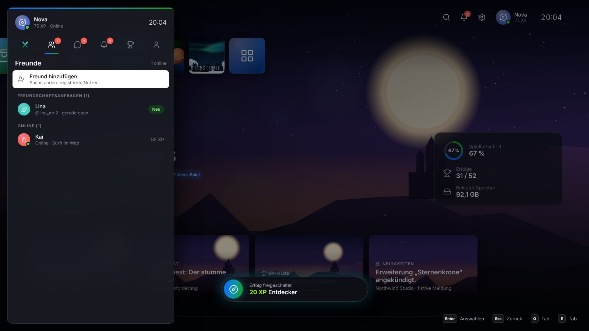 | 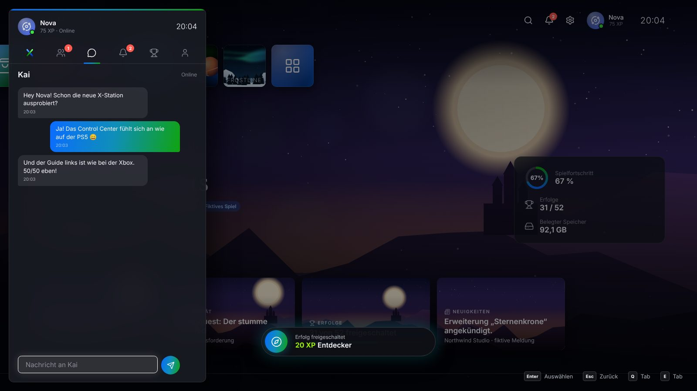 |
| 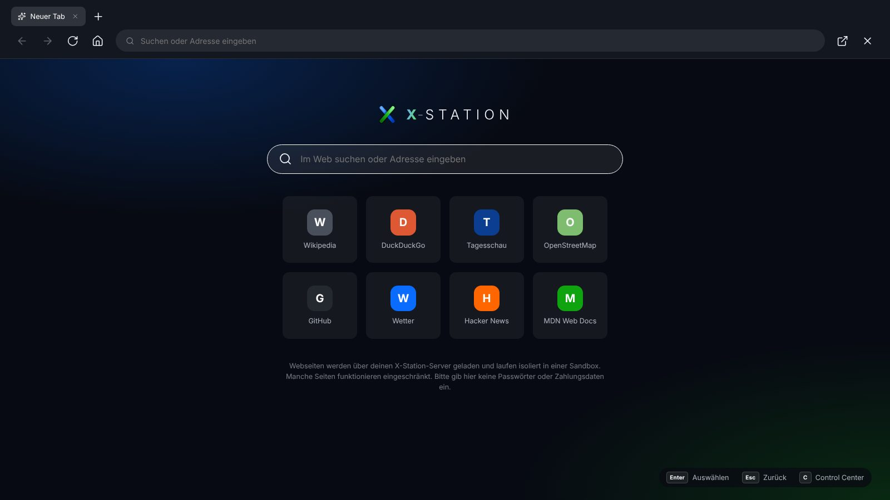 | 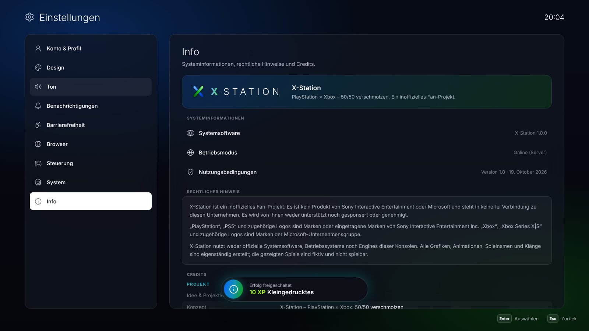 |
| 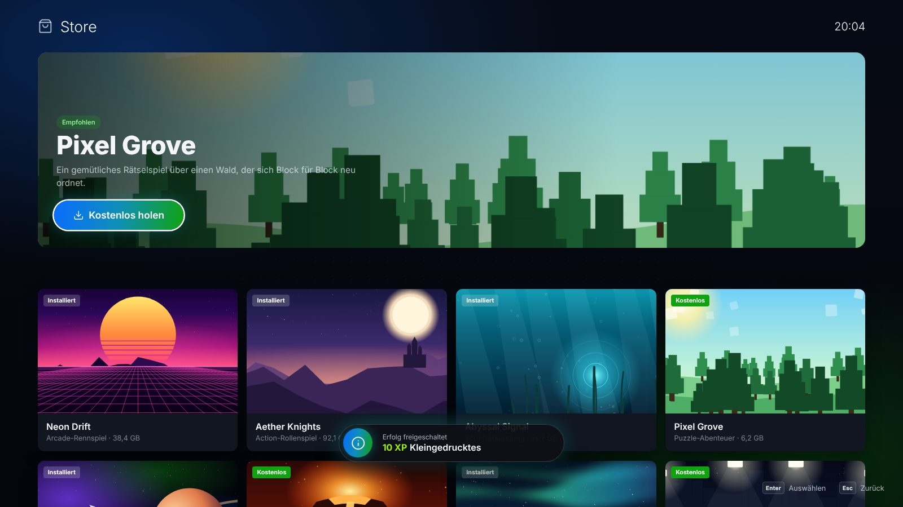 | 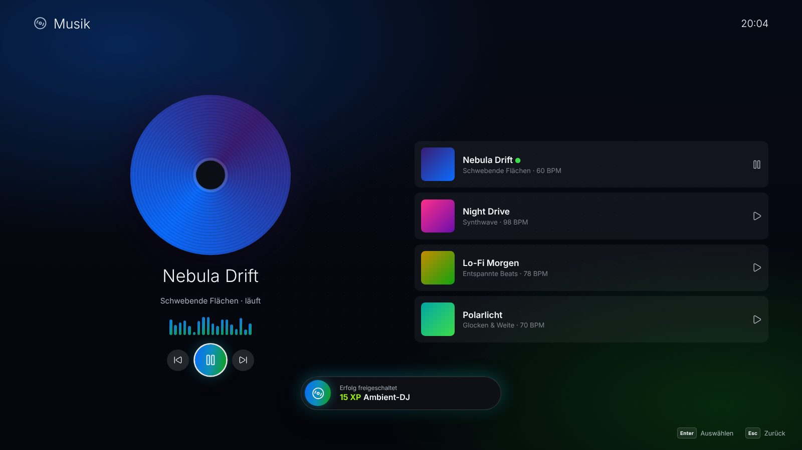 |
| 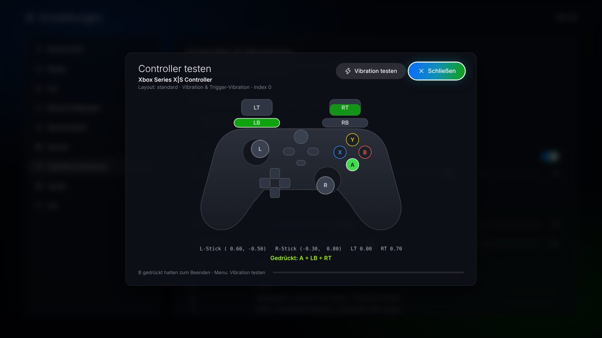 | 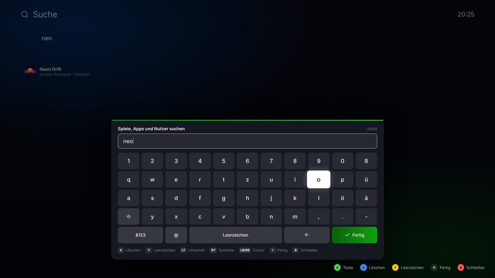 |
| 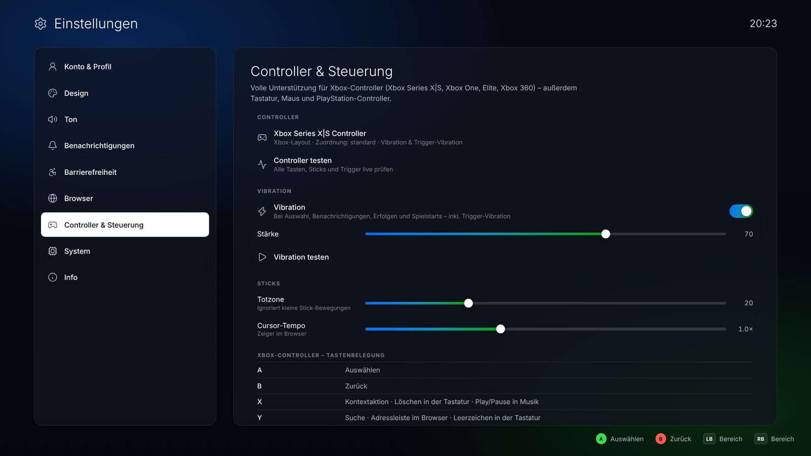 | 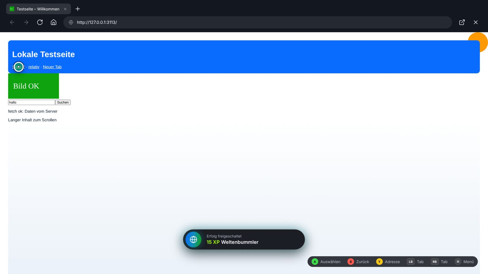 |

## Starten

Voraussetzung: **Node.js 20 oder neuer**. Der Server hat **keine Laufzeit-Abhängigkeiten**.

```bash
git clone https://github.com/idtbas/Xstation-.git
cd Xstation-
npm start
```

Dann **http://localhost:3000** öffnen. Wer sich im selben Netzwerk über die IP-Adresse des Rechners verbindet, kann sich ebenfalls registrieren und als Freund hinzugefügt werden.

| Umgebungsvariable | Standard | Bedeutung |
| --- | --- | --- |
| `PORT` | `3000` | Port des Servers |
| `DATA_DIR` | `./data` | Ordner für die Datenbank (`db.json`) und den Server-Schlüssel |
| `XSTATION_SECRET` | wird erzeugt | Geheimer Schlüssel für die Browser-Proxy-Signaturen |
| `TRUST_PROXY` | – | Auf `1` setzen, wenn ein Reverse-Proxy (z. B. Render) davor läuft |

Tests: `npm test` (Konten, Freunde, Nachrichten, Live-Ereignisse, Proxy, SSRF-Schutz, Controller-Zuordnung und Desktop-Erkennung).

## Online stellen

Damit Freundesliste und Chat zwischen verschiedenen Personen funktionieren, braucht X-Station den Node-Server. Drei Wege:

1. **Render.com (kostenlos):** Bei Render anmelden, dann **New + → Blueprint** und dieses Repository wählen. Die Datei `render.yaml` richtet alles ein. Im kostenlosen Tarif gehen die Daten bei einem Neustart verloren; für dauerhafte Konten eine *Persistent Disk* anlegen und `DATA_DIR` auf deren Pfad setzen.
2. **Docker:** `docker build -t x-station . && docker run -p 3000:3000 -v xstation-data:/data x-station`
3. **Beliebiger Server mit Node.js:** `npm start` (am besten hinter HTTPS).

**GitHub Pages (nur Vorschau):** Unter *Settings → Pages* als Quelle „GitHub Actions“ wählen und unter *Actions* den Workflow **GitHub Pages** starten. Ohne Server läuft X-Station im **lokalen Modus**: Konten und Freunde existieren dann nur im jeweiligen Browser, und der Browser lädt Seiten direkt (viele Seiten verbieten das Einbetten).

## Technik

```
server/            Node-Server ohne Abhängigkeiten
  app.js           REST-API, statische Dateien, Server-Sent Events
  lib/auth.js      scrypt-Passwörter, Tokens, Eingabeprüfung, Rate-Limits
  lib/db.js        JSON-Datenbank mit atomarem Speichern
  lib/events.js    Live-Ereignisse & Online-Status
  lib/proxy.js     Web-Proxy (SSRF-Schutz, Cookie-Speicher, Sandbox)
  lib/rewrite.js   HTML/CSS-Umschreibung für den Proxy
public/            Oberfläche (Vanilla-JS-Module, kein Build-Schritt)
  js/core/         Navigation, Eingabe, Controller-Zuordnung & Vibration, Klänge, Musik, API
  js/apps/         Bildschirme: Boot, Startseite, Control Center, Guide, Browser …
  js/ui/           Logo, Avatare, Spielgrafiken, Partikel, Dialoge, Bildschirmtastatur, Controller-Test
  js/data/         Spiele, Erfolge, Nutzungsbedingungen & Credits
test/              node:test-Tests
```

**Sicherheit**

- Passwörter werden nur als scrypt-Hash gespeichert. Sitzungs-Tokens liegen auf dem Server nur als SHA-256-Hash vor.
- Fehlgeschlagene Anmeldungen, Registrierungen und API-Aufrufe sind begrenzt.
- Der Browser-Proxy verlangt einen signierten Schlüssel pro Nutzer und blockiert private, lokale und Metadaten-Adressen auch nach der DNS-Auflösung. Er erlaubt nur Standard-Ports.
- Jede Seite aus dem Proxy erhält `Content-Security-Policy: sandbox` und läuft dadurch in einem eigenen, undurchsichtigen Ursprung. Sie kann weder Daten noch Sitzung der App lesen. Cookies fremder Seiten bleiben serverseitig pro Nutzer getrennt.
- Die App selbst läuft mit einer strengen Content-Security-Policy.

## Rechtliches & Credits

Die Nutzungsbedingungen (`public/js/data/legal.js`) muss man beim ersten Start akzeptieren. Unter **Einstellungen → Info** lassen sie sich jederzeit nachlesen, zusammen mit dem Haftungsausschluss und den Credits.

- Idee & Projektleitung: **idtbas**
- Programmierung, UI & GUI: **Claude Code (Anthropic)** im Auftrag von idtbas
- Schriftart [Inter](https://rsms.me/inter/) – SIL Open Font License 1.1
- Symbole [Lucide](https://lucide.dev) – ISC-Lizenz

Grafiken, Logo, Avatare, Spielbilder, Animationen und Klänge wurden eigens für X-Station erstellt.
